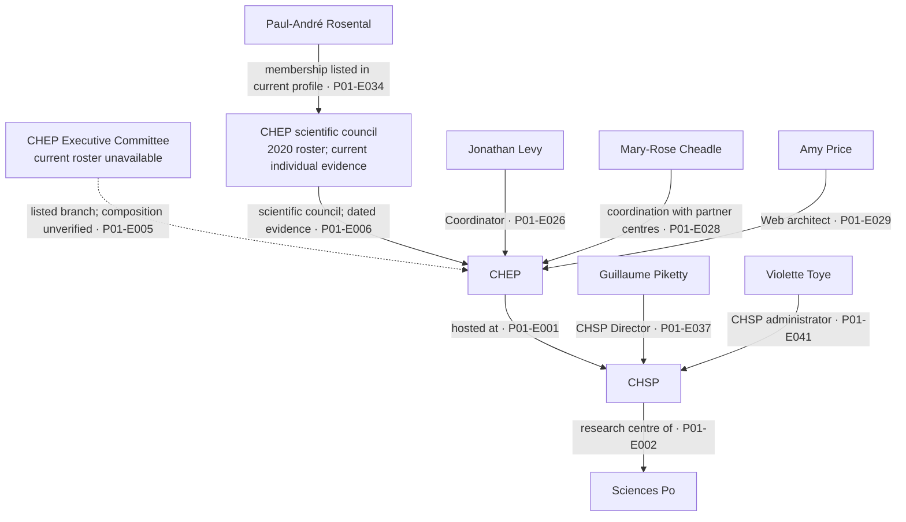
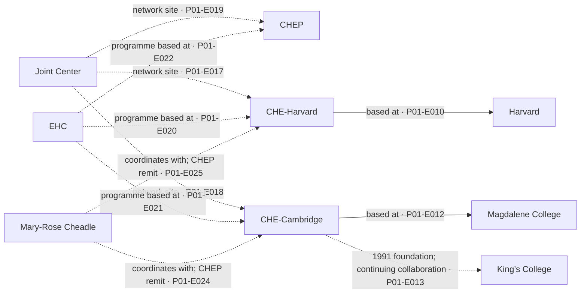

# CHEP organisation and partnership maps

**as_of_date: 2026-11-15.** Draft for institutional review. These are evidenced functions and connections, not a discovered line-management structure. Nodes resolve to [people.csv](people.csv) or [organisations.csv](organisations.csv); edge IDs resolve to [relationships.csv](relationships.csv). All cited sources accessed 2026-11-15.

## 1. Formal organisation and documented functions

A solid arrow means the specific labelled host, function or body relationship is supported. It does **not** mean “reports to”. A dotted arrow highlights a navigation-only/unverified-composition link, a partnership or dated institutional context. The current Executive Committee composition is unknown. “Conseil scientifique” and “Executive Committee” remain separate labels until their equivalence and remit are confirmed.

| Edge | Meaning / temporal scope | Evidence |
|---|---|---|
| P01-E001 | current public overview; established 2022 | [P01-SR03: Centre for History and Economics in Paris (CHEP)](https://www.sciencespo.fr/histoire/en/research/centre-for-history-and-economics-in-paris-chep/); [P01-SR04: Centre for History and Economics — Paris home](https://www.histecon.fr/en/) |
| P01-E002 | observed 2026-11-15; effective dates unknown | [P01-SR03: Centre for History and Economics in Paris (CHEP)](https://www.sciencespo.fr/histoire/en/research/centre-for-history-and-economics-in-paris-chep/); [P01-SR08: Research directorate and Support team](https://www.sciencespo.fr/histoire/en/the-centre/research-directorate-and-support-team/) |
| P01-E005 | observed 2026-11-15 | [P01-SR02: People — CHEP](https://histecon.fr/en/people.html) |
| P01-E006 | historical composition attested 2020-03-10; current individual profile corroboration | [P01-H003: Conseil scientifique, Formation restreinte, mardi 10 mars 2020; version validée au CS du 2 juin 2020](https://www.sciencespo.fr/sites/default/files/cd_cp/cs/2020/2020_03_10_CSFR.pdf); [P01-SR09: Paul-André Rosental](https://www.sciencespo.fr/histoire/fr/annuaire/rosental-paul-andre/) |
| P01-E026 | listed current; effective start/end unknown; start=date_unknown; end=date_unknown | [P01-SR01: Organisation — CHEP (English)](https://histecon.fr/en/organisation.html); [P01-SR03: Centre for History and Economics in Paris (CHEP)](https://www.sciencespo.fr/histoire/en/research/centre-for-history-and-economics-in-paris-chep/) |
| P01-E028 | listed current; effective start/end unknown; start=date_unknown; end=date_unknown | [P01-SR01: Organisation — CHEP (English)](https://histecon.fr/en/organisation.html) |
| P01-E029 | listed current; effective start/end unknown; start=date_unknown; end=date_unknown | [P01-SR01: Organisation — CHEP (English)](https://histecon.fr/en/organisation.html) |
| P01-E037 | listed current host-unit function; CHEP-specific remit not established; start=date_unknown; end=date_unknown | [P01-SR08: Research directorate and Support team](https://www.sciencespo.fr/histoire/en/the-centre/research-directorate-and-support-team/) |
| P01-E041 | listed current host-unit function; CHEP-specific remit not established; start=date_unknown; end=date_unknown | [P01-SR08: Research directorate and Support team](https://www.sciencespo.fr/histoire/en/the-centre/research-directorate-and-support-team/) |
| P01-E034 | listed on current profile; exact tenure unknown; start=date_unknown; end=date_unknown | [P01-SR09: Paul-André Rosental](https://www.sciencespo.fr/histoire/fr/annuaire/rosental-paul-andre/) |

The diagram shows two CHSP functions to make the host boundary visible. The full host support directory includes eleven people/functions in the tables; their CHEP allocations are not documented. Four scholars named as helping organise CHEP activities—Chessel, Mayer, Rosental and Rothschild—have collaboration records, not inferred executive-committee appointments. [CHSP support](https://www.sciencespo.fr/histoire/en/the-centre/research-directorate-and-support-team/); [French CHEP host overview](https://www.sciencespo.fr/histoire/fr/recherche/centre-for-history-and-economics-paris-chep/).

## 2. Partnership and research-programme map

The Joint Center node is a publicly documented network description, not an inferred legal parent. Programme and coordination arrows are connections, not supervisory authority. The CSV preserves college/university and Harvard FAS context beyond this compact view.

| Edge | Meaning / temporal scope | Evidence |
|---|---|---|
| P01-E019 | observed 2026-11-15 | [P01-PS04: Center for History and Economics: Welcome](https://histecon.fas.harvard.edu/index.html) |
| P01-E017 | observed 2026-11-15 | [P01-PS04: Center for History and Economics: Welcome](https://histecon.fas.harvard.edu/index.html) |
| P01-E018 | observed 2026-11-15 | [P01-PS04: Center for History and Economics: Welcome](https://histecon.fas.harvard.edu/index.html) |
| P01-E010 | observed 2026-11-15 | [P01-PS04: Center for History and Economics: Welcome](https://histecon.fas.harvard.edu/index.html); [P01-PS05: Contact Details](https://histecon.fas.harvard.edu/contact.htm) |
| P01-E012 | from 2010 in 2012 source; current overview corroborates base | [P01-PS04: Center for History and Economics: Welcome](https://histecon.fas.harvard.edu/index.html); [P01-PS17: Magdalene Matters, November 2012, Issue 36](https://www.magd.cam.ac.uk/sites/default/files/2025-05/magdalene_matters_issue_36.pdf) |
| P01-E013 | 1991 establishment; collaboration current in checked publication scheme | [P01-PS14: Harvard, Cambridge establish Joint Center for History and Economics](https://news.harvard.edu/gazette/story/2007/05/harvard-cambridge-establish-joint-center-for-history-and-economics/); [P01-PS20: King's College, Cambridge Publication Scheme](https://www.kings.cam.ac.uk/kings-college-cambridge-publication-scheme) |
| P01-E022 | observed 2026-11-15 | [P01-PS22: Economic History, Climate, and the Environment](https://histecon.fas.harvard.edu/ehc/) |
| P01-E020 | observed 2026-11-15 | [P01-PS22: Economic History, Climate, and the Environment](https://histecon.fas.harvard.edu/ehc/) |
| P01-E021 | observed 2026-11-15 | [P01-PS22: Economic History, Climate, and the Environment](https://histecon.fas.harvard.edu/ehc/) |
| P01-E025 | listed current; exact dates unknown | [P01-SR01: Organisation — CHEP (English)](https://histecon.fr/en/organisation.html) |
| P01-E024 | listed current; exact dates unknown | [P01-SR01: Organisation — CHEP (English)](https://histecon.fr/en/organisation.html) |

## Leadership/support overlay and historical context

| Centre / period | Documented public functions | Boundary |
|---|---|---|
| Paris, current checked listings | Jonathan Levy, Coordinator; Mary-Rose Cheadle, partner coordination; Amy Price, Web architect | Dates and employment/reporting arrangements not stated. [Organisation](https://histecon.fr/en/organisation.html). |
| Harvard, current checked listings | Emma Rothschild and David Yang, directors; Emily Gauthier, administration/finance; Jennifer Nickerson, research/fellowships; Amy Price, websites | Harvard roles do not create Paris membership. [Organization](https://histecon.fas.harvard.edu/organization.htm). |
| Harvard committee, current checked list | Abhijit Banerjee; Maya Jasanoff; Kenneth Mack; Emma Rothschild; Francesca Trivellato; David Yang | Same people may have separately evidenced Paris roles. [Executive Committee](https://histecon.fas.harvard.edu/executive.htm). |
| Cambridge, current corroborated leadership | Tim Harper, Director | Does not establish sole leadership or full committee/staff roster. [Cambridge profile](https://www.bennettschool.cam.ac.uk/about-us/person/tim-harper/). |
| Cambridge, historical observations | Harper Associate Director, Inga Huld Markan Executive Officer and Amy Price Webmistress in 2012; Paul Warde Director and William O’Reilly Assoc Director in 2021/22 | Current status not inferred from these observations. See source-linked role records. |
| Paris coordination history | Claire Lemercier with David Todd, 2019–2021; Todd coordination since 2022, attested in July 2025 | Levy's effective start and Todd's end remain unknown. [CV p. 11](https://lemercier.ouvaton.org/wp-content/uploads/2024/03/Lemercier-CV-mars-2024.pdf); [interview](https://www.sciencespo.fr/ecole-recherche/fr/actualites/entretien-avec-david-todd-directeur-des-etudes-en-histoire/). |

The 2007 announcement's joint-management and separate-executive-oversight arrangements are historical evidence for Cambridge/Harvard. They are not drawn as a current authority chain over Paris. [Harvard Gazette, 24 May 2007](https://news.harvard.edu/gazette/story/2007/05/harvard-cambridge-establish-joint-center-for-history-and-economics/).

**Before public use:** confirm the current Paris committee composition, terminology and remit; coordinator transition date; current Cambridge roster; and the institutionally preferred description of host versus partnership relationships. No assumption is made about who has committed to this review.
