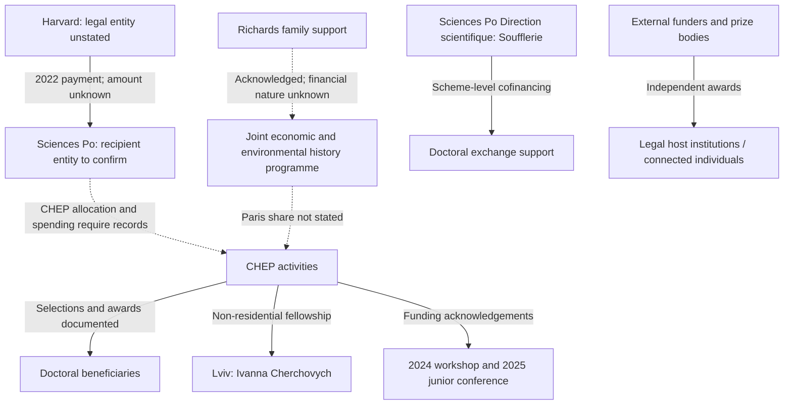

# P03 — Historical grants, awards, and funding flows

**As of 15 November 2026. Research draft; not an audited financial statement.** All external sources linked below were accessed on that date. Source titles, document dates, locators and retrieval limitations are recorded in [sources.csv](sources.csv). Only P03 was executed; other workstream reports were not required or used.

## Decision brief

**What we learned.** Public evidence establishes a Harvard payment for CHEP received in 2022, doctoral bursary selections, a fellowship for a scholar in Lviv, and explicit funding of scholarly meetings. It also identifies independent grants held by CHEP-connected researchers. These are different funding relationships. The [December 2022 institutional minutes, p. 3](https://www.sciencespo.fr/sites/default/files/cd_cp/ci2022/PVCI20221213.pdf) confirm the Harvard receipt without giving its amount. The [October 2022 FNSP minutes, p. 22](https://www.sciencespo.fr/sites/default/files/cd_cp/ca/2022/PVCA20221019.pdf) place a rounded €0.9 million CHEP effect under *charges de fonds dédiés*. That figure is not evidence of a €900,000 award or expenditure. No defensible cumulative CHEP income or spending total emerges from the checked corpus.

**What CHEP can do with it.** Use the ledger as the evidence base for a modest “research supported” account, with separate sections for centre support and affiliates’ achievements. Dated announcements support four doctoral recipients in [2025](https://www.sciencespo.fr/ecole-recherche/fr/actualites/quatre-doctorants-du-centre-d-histoire-laureats-de-la-bourse-d-excellence-du-chep/) and four in [2026](https://www.sciencespo.fr/ecole-recherche/en/news/four-young-history-researchers-chep-2026-grant/); their individual payments remain unknown. The [2027 studentship call](https://histecon.fr/en/research_grants.html) is a separate prospective record, limited to eligible first-to-third-year Sciences Po PhD students, with a €1,000 expense ceiling. It establishes neither awards nor Master's eligibility.

**What the student can deliver next.** The following are proposals, estimated against five student hours per week and no confirmed discretionary budget. They require no new software or spending commitment.

| Recommended action | Finding → benefit | Student effort and cash assumptions | Support and success measure |
|---|---|---|---|
| Reconcile the 2022 funding agreement and accounts | Confirmed receipt but missing terms → trustworthy institutional attribution | 5 setup hours over one week; 0.5 hour monthly maintenance; €0 incremental cash using existing storage | Finance/research administration supplies a redacted agreement and accounting explanation. Success: legal recipient, amount basis and period resolved, or explicitly retained as unknown. |
| Validate one doctoral award register | Named awards but no payment trail → make student support visible without inflated totals | 4 setup hours; 0.5 hour quarterly; €0 incremental cash | Scholarship administrator checks year, duplicate identities and award versus reimbursement. Success: every published recipient has one sourced award-year record and an explicit payment-status field. |
| Prepare a short annual-report support box | Funding acknowledgements exist → useful evidence of scholarly activity | 3 setup hours after the first two actions; 1 hour annually; €0 for a digital draft | Academic coordinator reviews attribution; communication function clears publication. Success: approved copy with no unresolved monetary claim presented as fact. |

Together this is **12 setup hours**, spread over three weeks within the five-hour scenario, plus about **9 maintenance hours annually**. Administrator and academic review time is additional: provisionally 1–2 hours for initial reconciliation and 30 minutes for editorial review. These are estimates, not commitments. The institutional decision needed is whether to prioritise this small record-reconciliation exercise and identify the responsible counterpart. The retrieved [organisation page](https://histecon.fr/en/organisation.html) calls Jonathan Levy **Coordinator**.

## Scope and reading the files

The principal period is the documented Paris collaboration from **2019 to 15 November 2026**, retaining evidence of earlier prehistory rather than imposing a single founding date. The [CHEP home page](https://www.histecon.fr/en/) distinguishes collaboration in 2019 from establishment in 2022; the [5 June 2019 workshop page](https://histecon.fr/en/spatial.html) identifies a launch event. The [March 2020 scientific-council minutes, section 10](https://www.sciencespo.fr/sites/default/files/cd_cp/cs/2020/2020_03_10_CSFR.pdf) describe earlier expansion approximately. That wording does not establish an exact earlier founding date. The fifth anniversary of the 2022 establishment would fall in 2027, subject to institutional choice of milestone.

The independently assembled [cohort](cohort.csv) preserves associates, governance/coordination, fellows, former fellows, visitors and scholarship beneficiaries. A documented award can establish a historical connection without implying current membership. Administrative/web personnel are retained as boundary/context records where listed; their personal finances are outside the research. Cambridge/Harvard membership by itself is insufficient for Paris inclusion. Earlier independent awards are explicitly marked and never counted as CHEP income.

[funding_ledger.csv](funding_ledger.csv) contains documented awards, appointments and explicit funding acknowledgements. Date conflicts remain flagged. [calls_and_unverified_leads.csv](calls_and_unverified_leads.csv) holds calls, support of unverified financial nature, accounting observations and unresolved candidates. Its inclusion of a *verified* accounting observation does not turn that observation into an award. [funding_coverage.csv](funding_coverage.csv) records what was checked and what remains. [coverage.md](coverage.md) supplies the source tree and reconciliation decisions.

## What the funding relationships establish

### Incoming institutional and joint-programme support

**Verified:** an institutional budget discussion says the Harvard payment relating to CHEP arrived in 2022. The precise contracting entities, instrument, full commitment, instalment schedule and restrictions are not supplied. The [6 December minutes, pp. 3–4](https://www.sciencespo.fr/sites/default/files/cd_cp/ci2022/PVCI20221206.pdf) discuss CHEP receipts and corresponding dedicated-fund charges. Together these documents justify retaining the transaction and its accounting context separately; they do not justify deriving an operating budget.

**Verified acknowledgement, financial nature and allocation unverified:** the [Economic History, Climate, and the Environment programme](https://histecon.fas.harvard.edu/ehc/) names the three centres and acknowledges continuing support from Carol Richards, the late David K. Richards and the Richards family. The word “support” does not itself establish a donation or financial award, so this is retained as a lead. No public figure or Paris allocation is stated. It would be an inference to identify this support with the 2022 Harvard receipt. The ledger deliberately supplies no parent-child relationship between them.

The [2023 Sciences Po research report, p. 42](https://www.sciencespo.fr/recherche/sites/sciencespo.fr.recherche/files/SciencesPo_RA2023-2_0.pdf) places CHEP within *La soufflerie interdisciplinaire*. This establishes institutional context, not a new discrete 2023 grant. It remains a lead for the administrator rather than a fabricated allocation.

### Support administered or distributed through CHEP

The doctoral evidence spans different schemes and dates. The [March 2020 council record, pp. 14–15](https://www.sciencespo.fr/sites/default/files/cd_cp/cs/2020/2020_03_10_CSFR.pdf) reports approximately six one-month bursaries already awarded. The [French host page](https://www.sciencespo.fr/histoire/fr/recherche/centre-for-history-and-economics-paris-chep/) identifies four selections in 2020 and describes Sciences Po Direction scientifique cofinancing through *La soufflerie*. The aggregate and named records may overlap; they cannot be added as ten awards. Selection also does not establish that pandemic-disrupted travel occurred or money was reimbursed.

The [2026 recipient announcement](https://www.sciencespo.fr/ecole-recherche/en/news/four-young-history-researchers-chep-2026-grant/) provides a particularly useful annual-report unit: a defined year and four named recipients. Historical beneficiary profiles and the 2025 announcement extend the record. None warrants assigning each recipient €1,000 from the later 2027 call. Likewise, a public postdoctoral appointment proves an appointment; the advertised salary in a separate call does not prove an individual's contract or payroll expenditure.

CHEP’s [announcements archive](https://histecon.fr/en/announcements_archive.html) identifies Ivanna Cherchovych as recipient of a funded non-residential fellowship at the Center for Urban History in Lviv. The host's emergency-fellowship documentation corroborates the institutional support, but no individual amount was established. This is documented scholarly support, distinct from an invitation or routine visit.

Explicit monetary language also matters for events. The [workshop introduction](https://histecon.fr/emotions_climate_environment/index.html) acknowledges CHEP funding; the [event archive](https://histecon.fr/en/events_recent.html) supplies its date, 24 May 2024. The [27–28 November 2025 *Invisible Actors* programme](https://www.sciencespo.fr/histoire/sites/sciencespo.fr.histoire/files/2025-11-27ET28-INVISIBLE-ACTORS-VERSION5.pdf) names CHEP and the School of Research as cofunders. Their shares and actual expenditure are unknown. Other pages say only “supported,” “hosted,” or “in collaboration with”; those statements remain outside the monetary ledger unless financial evidence is found.

### Independent funding connected through people

The ledger separates the researcher, legal recipient and project. For example, the [European Commission’s SLAVEVOICES record, agreement 819353](https://cordis.europa.eu/project/id/819353) establishes project funding; [Princeton’s award announcement](https://nes.princeton.edu/news/oualdi-awarded-european-research-council-consolidator-grant) identifies M’hamed Oualdi as the researcher. It does not establish CHEP income. Where the funder lists institutional beneficiary components, they are children of the project total, not additional money raised.

Historical grants such as [SILICOSIS, agreement 295817](https://cordis.europa.eu/project/id/295817), associated with Paul-André Rosental, predate the documented Paris collaboration. They show relevant research experience but cannot be presented as CHEP fundraising successes. Prizes announced for connected scholars are separately typed as prizes, and prize existence is separated from a verified cash payment. The result is a public research inventory, not an assessment of individuals' wealth, remuneration or available balances.

## Funding-flow diagram

Solid arrows indicate a documented relationship; dotted arrows mark an unresolved transfer or allocation. No arrow represents a quantified expenditure unless explicitly labelled.

The diagram's separation between external awards and CHEP activities is an attribution safeguard. For 2020 mobility, the named beneficiaries and approximate aggregate are not separate spending pools. For the 2022 receipt, an accounting charge is not a downstream grant. Only an award identifier or explicit allocation record can establish a financial parent-child link.

## Totals and supported purposes

**No overall monetary total is reported.** Unknown amounts are not zero. Annual salaries, maximum allowances, multi-year project contributions, prizes, dedicated-fund accounting and expenditure are not interchangeable. Even a subtotal of selected external grants would be a biased inventory statistic, not a measure of CHEP resources.

One useful reconciliation is internal to a single funder record: [SLAVEVOICES in CORDIS](https://cordis.europa.eu/project/id/819353) lists **€1,999,975** in total EU contribution, comprising **€1,578,285** for the Fondation nationale des sciences politiques and **€421,690** for the European University Institute. The components sum to the parent; summing all three would double count. This is a project total, not an annual amount or a CHEP allocation. [CORDIS](https://cordis.europa.eu/project/id/819353) gives 31 August 2027, while the [Sciences Po ERC register](https://www.sciencespo.fr/recherche/fr/recherches/conventions-de-recherche/erc/) gives August 2028; the ledger retains the funder date and flags the conflict.

Supported purposes can be described, but expenditure shares cannot be calculated:

| Purpose | Evidence unit | Defensible interpretation |
|---|---|---|
| Doctoral research and mobility | Named selections/awards and an approximate 2020 aggregate | Beneficiary-level history; disbursement and completed travel unknown |
| Early-career research employment | Named postdoctoral appointments, separate from calls | Research capacity supported; payroll amount not established |
| Scholarly continuity in wartime | Named Lviv fellowship | One documented recipient; no claim about the full emergency programme budget |
| Scholarly exchange | Explicit workshop/conference funding acknowledgements | Financial support documented; expenditure and attendance unknown |
| Affiliates’ independent research and recognition | Funder, host or prize-body records | Connected scholarship; not centre-controlled resources |

## Missing records and an annual-report prototype

The highest-value administrative requests are narrow: (1) the 2022 Harvard agreement and receipt schedule, including legal parties and permitted purposes; (2) a reconciliation of the €0.9m dedicated-fund entry with receipts and releases; (3) award registers by year, with selection date, beneficiary, authorised allowance and actual reimbursements separately; (4) fellowship appointment dates and funder/host allocation, without personal payroll detail; (5) the Lviv support agreement and project-level event allocations; and (6) permission to publish an agreed summary. [administrator_questions.md](administrator_questions.md) translates these into a short review checklist. No records were requested or messages sent during this research.

**Draft public-facing support box:** “CHEP supports scholarly exchanges through doctoral research awards, early-career fellowships and contributions to research meetings. Sciences Po announced four doctoral research-grant recipients for 2026. Public acknowledgements also document CHEP funding for a 2024 workshop on emotions, climate and the environment, and cofunding of a 2025 junior conference on international law. These activities sit alongside independent grants and prizes held by researchers connected with the centre. Financial totals will be reported only where the recipient, period and amount basis have been reconciled.” Sources: the [2026 announcement](https://www.sciencespo.fr/ecole-recherche/en/news/four-young-history-researchers-chep-2026-grant/), [workshop page](https://histecon.fr/emotions_climate_environment/index.html) and [conference programme](https://www.sciencespo.fr/histoire/sites/sciencespo.fr.histoire/files/2025-11-27ET28-INVISIBLE-ACTORS-VERSION5.pdf). This is a draft for review, not published copy.

## Methods, consequential decisions and limits

Research began with `Summary.md` and the entire shared source map, then followed Paris navigation, French/English variants, dated announcements, institutional minutes, project pages, public professional profiles and funder records. Queries checked the historical period and sought orphaned grant/fellowship pages. Duplicate URLs and repeated announcements were reconciled; source-ID aliases remain recoverable. Dates of publication, awards, project periods and access are kept distinct where supplied.

Most browsing results were indexed or cached renditions, with reported crawl ages recorded. Direct HTTP access failed in the local environment. A failed retrieval does not establish a broken website; stale search snippets do not override an opened page. No dated Wayback snapshot was obtained. Some PDFs were readable as extracted text but not as screenshots; their page locators are preserved and that limitation is disclosed. No bulk crawl, private-system access, applications or communications occurred.

This is a documented first public-corpus ledger with explicit remaining retrieval work, not a complete financial census. The inaccessible historical people branches and unreviewed CV/funder leads are listed in coverage. Evidence of a fellowship is not always evidence of its funder, and a present roster does not prove an affiliation at an earlier award date. The files retain these uncertainties so that later institutional review can improve the record without silently rewriting history.
